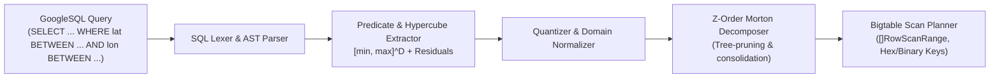

# BlackGrid

**BlackGrid** is a Go-based GoogleSQL query planner and multidimensional spatial/temporal indexing engine for Google Cloud Bigtable. It parses GoogleSQL queries, maps multidimensional bounded range predicates into Morton codes (Z-order space-filling curves), and generates optimized sets of 1D Bigtable row scan ranges.

---

## Architecture Overview

Google Cloud Bigtable stores data sorted lexicographically by a single row key. BlackGrid bridges multidimensional range queries (e.g., spatial latitude/longitude bounding boxes or spatio-temporal cubes) to Bigtable's 1D key space:



1. **GoogleSQL AST & Parser (`pkg/sql`)**: Parses GoogleSQL `SELECT` queries, extracting dimensional interval predicates (`BETWEEN`, `>=`, `<=`, `=`, `< `, `>`) and isolating residual filters (e.g. non-indexed columns).
2. **Morton / Z-Curve Core (`pkg/zcurve`)**: Fast bit-interleaving and compacting for 2D, 3D, and generic $N$-dimensions with > 400M ops/sec throughput using bit manipulation masks.
3. **Range Decomposer (`pkg/zcurve`)**: Decomposes multidimensional hypercubes into minimal sets of 1D Morton intervals with zero false-negative recall and configurable scan range budgets (`max_ranges`).
4. **Dimension Mapping & Quantization (`pkg/mapping`)**: Normalizes real-world continuous coordinates (lat/lon, epoch timestamps, floats, integers) to $k$-bit unsigned integers.
5. **Bigtable Key & Scan Planner (`pkg/bigtable`)**: Constructs Bigtable row keys preserving byte lexicographical order (both 8-byte big-endian binary and 16-character hex formats) and produces scan ranges.

---

## Directory Layout

```
.
├── cmd/
│   └── blackgrid/             # Interactive CLI tool for testing and query inspection
├── pkg/
│   ├── zcurve/                # Morton code bit-interleaving, decoding, and interval decomposition
│   │   ├── decomposer.go      # Spatial tree decomposition into 1D scan intervals
│   │   ├── interval.go        # Interval merging and consolidation
│   │   ├── morton2d.go        # 2D bit interleaving (32-bit x, y -> 64-bit uint)
│   │   ├── morton3d.go        # 3D bit interleaving (21-bit x, y, z -> 64-bit uint)
│   │   └── morton_nd.go       # N-dimensional bit interleaving
│   ├── sql/                   # GoogleSQL lexer, parser, and predicate bounds extractor
│   │   ├── ast.go             # AST node representations
│   │   ├── lexer.go           # Lexical scanner for GoogleSQL tokens
│   │   ├── parser.go          # Recursive-descent SQL parser
│   │   └── extractor.go       # Hypercube extractor & residual filter isolation
│   ├── mapping/               # Coordinate quantization & table schemas
│   │   ├── quantizer.go       # Normalization to [0, 2^B - 1]
│   │   └── schema.go          # Dimension & table schema specifications
│   └── bigtable/              # Bigtable row key generator & scan planner
│       ├── key.go             # Lexicographical row key generation
│       └── planner.go         # Query plan generator
└── test/
```

---

## Quickstart CLI

Run a query plan against a 2D geographic dataset:

```bash
go run ./cmd/blackgrid -query "SELECT id, latitude, longitude, event_name \
  FROM geo_events \
  WHERE latitude BETWEEN 37.75 AND 37.80 \
    AND longitude BETWEEN -122.45 AND -122.40 \
    AND status = 'ACTIVE' \
  LIMIT 100"
```

Output:

```text
=== BlackGrid GoogleSQL to Bigtable Morton Scan Planner ===

Input Query:
  SELECT id, latitude, longitude, event_name 
  FROM geo_events 
  WHERE latitude BETWEEN 37.75 AND 37.80 
    AND longitude BETWEEN -122.45 AND -122.40 
    AND status = 'ACTIVE' 
  LIMIT 100

Target Table: geo_events
Dimensions:   latitude [37.7500, 37.8000] x longitude [-122.4500, -122.4000]

Residual Predicates (Post-Filters / Bigtable Column Filters):
  • (status = 'ACTIVE')

Generated Bigtable Scan Ranges (4 total, max budget 16):
  [ 1] Morton Range: [4d91ed0000000000, 4d91edffffffffff] (size: 1099511627776)
       Start Key:    67656f2334643931656430303030303030303030
       End Key:      67656f233464393165646666666666666666666623ff
  [ 2] Morton Range: [4d91ef0000000000, 4d91efffffffffff] (size: 1099511627776)
       Start Key:    67656f2334643931656630303030303030303030
       End Key:      67656f233464393165666666666666666666666623ff
  [ 3] Morton Range: [4d91f80000000000, 4d91f8ffffffffff] (size: 1099511627776)
       Start Key:    67656f2334643931663830303030303030303030
       End Key:      67656f233464393166386666666666666666666623ff
  [ 4] Morton Range: [4d91fa0000000000, 4d91faffffffffff] (size: 1099511627776)
       Start Key:    67656f2334643931666130303030303030303030
       End Key:      67656f233464393166616666666666666666666623ff
```

---

## Go API Example

```go
package main

import (
	"fmt"
	"log"

	"github.com/johanastborg/BlackGrid/pkg/bigtable"
	"github.com/johanastborg/BlackGrid/pkg/mapping"
)

func main() {
	// 1. Define schema: 2D Geographic with "geo#" key prefix
	schema, err := mapping.NewGeo2DSchema("geo_events", "geo#")
	if err != nil {
		log.Fatal(err)
	}

	// 2. Initialize planner
	planner := bigtable.NewPlanner()

	// 3. Plan query with a maximum of 16 Bigtable scan ranges
	query := `SELECT * FROM geo_events 
		WHERE latitude BETWEEN 40.70 AND 40.75 
		  AND longitude BETWEEN -74.02 AND -73.95`

	plan, err := planner.Plan(schema, query, 16, bigtable.HexFormat)
	if err != nil {
		log.Fatal(err)
	}

	fmt.Printf("Generated %d scan ranges for table %s:\n", len(plan.ScanRanges), plan.TableName)
	for i, r := range plan.ScanRanges {
		fmt.Printf("Range %d: [%s -> %s]\n", i+1, r.StartHex, r.EndHex)
	}
}
```

---

## Testing & Benchmarks

Run all unit tests:

```bash
go test -v ./...
```

Run Morton encoding/decoding benchmarks:

```bash
go test -bench=. ./pkg/zcurve/...
```

Typical performance on Apple Silicon:
* `BenchmarkEncode2D`: ~2.5 ns/op (~400,000,000 ops/sec)
* `BenchmarkDecode2D`: ~2.2 ns/op (~450,000,000 ops/sec)
